# DbCraft

Client database universale desktop scritto in **Flutter**, ispirato a
[DBeaver](https://github.com/dbeaver/dbeaver). Al posto di Java/JDBC la
connettività è basata su **ODBC**, chiamato direttamente tramite `dart:ffi`:
qualsiasi database con un driver ODBC (SQL Server, PostgreSQL, MySQL/MariaDB,
Oracle, Db2, SQLite, Snowflake, Access, Firebird, DuckDB, …) è utilizzabile.

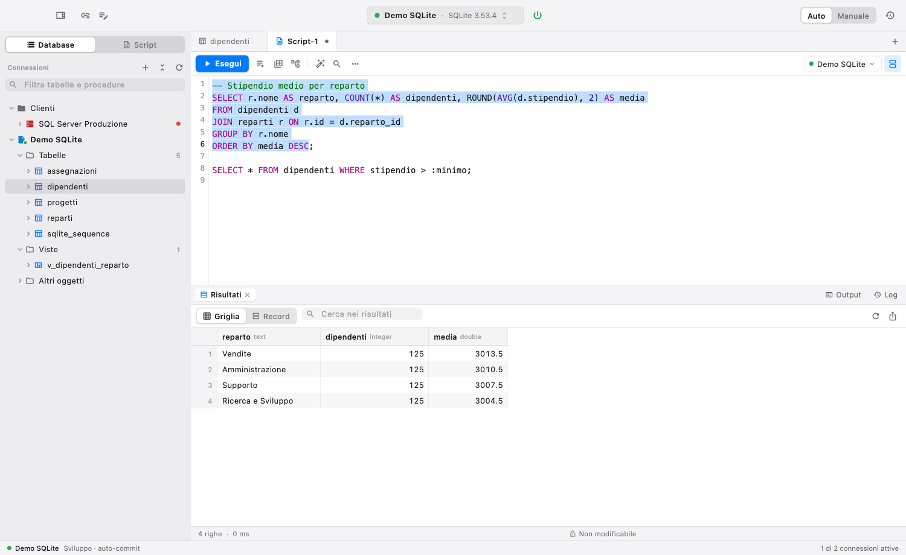

## Funzionalità

| Area | DBeaver | DbCraft |
|---|---|---|
| Connessioni | Wizard, driver JDBC | Wizard con 3 modalità: **Driver ODBC** (host/porta/db con template per i DBMS più diffusi), **DSN**, **stringa di connessione** libera; test connessione; parametri extra del driver; password salvata o richiesta al login |
| | Tipo connessione (dev/test/prod), cartelle, sola lettura, auto-commit, catalogo di default, bootstrap query | ✓ tutti (conferma prima di modificare dati su connessioni di *Produzione*) |
| Driver Manager | Driver JDBC | Elenco driver ODBC installati (`SQLDrivers`) e DSN utente/sistema (`SQLDataSources`); su macOS **installazione dei driver** SQL Server, PostgreSQL, MariaDB/MySQL e SQLite via Homebrew (licenza Microsoft, log in tempo reale, registrazione in `odbcinst.ini`) |
| Database Navigator | Albero lazy | Connessione → catalogo → schema → Tabelle/Viste/Altri/Procedure/Sequenze → Colonne/Chiavi/CHECK/FK/Riferimenti/Indici/Trigger; cartelle **Sicurezza** (utenti, ruoli, login) e degli oggetti specifici del DBMS; database e schemi di sistema (master, msdb, pg_catalog, information_schema…) raccolti in una cartella **Sistema** o nascosti; su PostgreSQL **tutti i database del server** in una sola connessione (ognuno con sessioni proprie, aperte al primo uso: editor, dati, design e export lavorano sul database dell'oggetto; disattivabile con "Mostra tutti i database"); filtro; menu contestuali con "Nuovo…/Modifica…/Rinomina…/Elimina…"; F5, ⌥⌘N crea un oggetto nel contesto selezionato |
| Editor SQL | Evidenziazione, autocompletamento, esecuzione | Evidenziazione sintassi, numeri di riga, **autocompletamento** (keyword, funzioni, tabelle, colonne anche via alias), trova/sostituisci, commenti, formattazione, maiuscolo/minuscolo |
| | Esecuzione | Istruzione sotto il cursore o selezione (Ctrl/⌘+Invio), in nuova scheda (Ctrl/⌘+\\), **script** (Alt+X / F5) con statistiche e gestione errori, **piano di esecuzione**, **annullamento** (`SQLCancel`), **parametri** `:nome` e `?` con dialogo, output del server (PRINT/NOTICE), log di esecuzione, più result set per istruzione |
| | Script | Script salvati automaticamente nel workspace, pannello *Script*, apri/salva come |
| Griglia risultati | Data editor | Paginazione (fetch size) e caricamento automatico allo scroll, ordinamento, ricerca, vista **record**, selezione multipla, copia (anche con intestazioni / CSV / JSON / Markdown / SQL), incolla |
| | Modifica dati | Modifica in linea, editor valori (testo/JSON/hex, carica/salva file), NULL, aggiungi/duplica/elimina righe, **salvataggio transazionale** con UPDATE/INSERT/DELETE parametrici basati sulla chiave primaria (o chiave virtuale), anteprima SQL delle modifiche |
| Editor oggetti | Entity editor | Proprietà, Dati (filtro WHERE / ORDER BY e "filtra per valore"), Colonne, Vincoli e chiavi, Indici, **DDL**, **Diagramma ER**, **Permessi**; per le tabelle è un **designer modificabile** (colonne in linea, vincoli, indici, pagina *Modifiche* con lo script dal vivo, annulla/ripeti, ⌘S), per le viste la pagina **Definizione** con verifica della query |
| Design dello schema | Create/Edit/Drop | **Nuovo database / schema / tabella / vista / sequenza / trigger / procedura / funzione**, anche duplicando una struttura. Vincoli completi: PK, UNIQUE, CHECK, FK (regole, MATCH, DEFERRABLE), disabilita/abilita, aggiungi senza validare, verifica preventiva dei dati (orfani, duplicati, NULL) con "Apri le righe". Indici con DESC, INCLUDE, filtro, metodo, ricostruzione e disattivazione. Ogni modifica passa da un'**anteprima dello script** (copia, apri nell'editor), in transazione dove il DBMS lo consente, con doppia conferma in *Produzione* |
| Amministrazione | Users and roles | Scheda **Utenti e ruoli** (Database › Utenti e ruoli…): utenti, ruoli e login con i loro attributi, appartenenze, matrice dei **permessi** sugli oggetti e privilegi di sistema, DDL. Le **password** sono segreti dello script: mascherate nell'anteprima, mai nella cronologia |
| Oggetti specifici | ✓ | PostgreSQL: estensioni, tipi enumerati, domini, **policy RLS**, vincoli di esclusione. SQL Server e Oracle: sinonimi. Oracle: **package** (specifica e corpo, errori di compilazione). MySQL/MariaDB: **eventi**. Firebird: domini. Snowflake: warehouse, stage, formati di file |
| Diagramma ER | ✓ | Da FK, trascinabile, zoom, disposizione automatica, esportazione PNG |
| Transazioni | Auto/Manual commit | Auto-commit / commit manuale, Commit, Rollback, contatore istruzioni pendenti, verifica alla disconnessione |
| Data transfer | Export/Import | Esporta in CSV, TSV, JSON, XML, HTML, Markdown, SQL INSERT, testo (su file o appunti, streaming di tabelle intere); **import CSV** con mappatura colonne |
| Query Manager | Cronologia | Cronologia persistente con ricerca, filtro errori, riapertura in editor |
| Generazione SQL | ✓ | SELECT / INSERT / UPDATE / DELETE / DDL / CALL, TRUNCATE, DROP, conteggio righe |
| Preferenze | ✓ | Tema chiaro/scuro/sistema, font, fetch size, testo NULL, autocompletamento, delimitatore a riga vuota, oggetti di sistema nel navigator, libreria Driver Manager personalizzata |

### Funzionalità PRO (equivalenti a DBeaver Pro / Team / Enterprise / Ultimate)

| Area | DbCraft |
|---|---|
| NoSQL e cloud | Driver **integrati** in Dart, senza ODBC: **MongoDB** (OP_MSG, SCRAM, X.509, AWS, OIDC, `mongodb+srv://`, sintassi shell `db.coll.find(...)`), **Redis** (RESP2/3, ACL, TLS, Entra ID, ElastiCache IAM), **Apache Cassandra** (CQL v4/v3, paging), **Google BigQuery** (REST). Template ODBC per Redshift, BigQuery, Databricks, Athena, MongoDB Atlas SQL, Cassandra, ClickHouse, Trino. Navigator, griglia, export e un sottoinsieme SQL (`SELECT * FROM … WHERE … ORDER BY … LIMIT`) funzionano anche sui NoSQL. **Design**: MongoDB (database, collezioni capped e time series, validatori, indici TTL/parziali/nascosti, viste con pipeline, utenti e ruoli), Cassandra (keyspace, tabelle con chiavi di partizione e clustering, indici SAI, tipi, viste materializzate, ruoli e permessi), Redis (utenti ACL), BigQuery (dataset, tabelle partizionate e in cluster, permessi IAM) |
| Storage a oggetti (S3, Azure Blob, GCS) | Pannello **Storage** (barra laterale *Storage*): account S3 (anche MinIO/R2), Azure Blob Storage (anche l'emulatore Azurite), Google Cloud Storage di qualsiasi regione; cartelle, carica/scarica con avanzamento, rinomina, elimina, link di condivisione (presigned / SAS / signed URL), apertura nell'editor SQL, import CSV in tabella. Credenziali: profili `~/.aws`, SSO/`credential_process`, assume role, IMDS, Azure CLI, service principal, managed identity, shared key/SAS, service account Google, ADC, `gcloud` |
| Sicurezza | **Vault cifrato** (AES‑256‑GCM) per password, token e chiavi; **master password** opzionale (PBKDF2‑SHA256) con schermata di sblocco all'avvio, blocco manuale (⌘⇧L) e per inattività. Le password non sono più in `connections.json` |
| Autenticazione enterprise | Per connessione: **Kerberos**/integrata, **Microsoft Entra ID** (password, interattiva/MFA, integrata, service principal, managed identity, Azure CLI), **SSO/SAML** nel browser, **Okta**, **AWS IAM** (Redshift, Athena, RDS con token), **OAuth**, **coppia di chiavi** (Snowflake JWT, service account) |
| Assistente AI (Claude) | Spiega query e oggetti (tabelle, viste, procedure), **"Correggi con AI"** sugli errori in due clic, genera SQL/CQL/comandi MongoDB/Redis dal linguaggio naturale, chat per connessione. Chiave API nel vault, modello ed effort configurabili, contesto dello schema opzionale, nessun dato inviato senza consenso |
| Query builder visuale | Tabelle trascinabili, join automatici dalle FK o trascinando colonna→colonna, colonne/alias/aggregati/ordinamento/filtri/HAVING/DISTINCT/limite, SQL generato dal vivo per il dialetto, esecuzione integrata |
| Grafici e vista per analisti | Vista **Grafico** sui risultati (barre, linee, aree, torta, dispersione, aggregazioni, PNG). **Vista semplificata** (Vista › Vista semplificata): filtri visuali a chip, solo tabelle e viste, strumenti per sviluppatori nascosti |
| Sviluppo schema | **Designer di tabelle** nell'editor oggetti (vedi *Design dello schema*). **ERD in modifica**: nuove tabelle, colonne, relazioni trascinando, eliminazioni, script DDL rivisto ed eseguito. **Confronto schemi e migrazione** anche tra DBMS diversi. **Confronto dati** tra tabelle (merge/hash join) con script di sincronizzazione. **Dati di test** (nomi, email, codice fiscale, IBAN, P.IVA, FK reali, sequenze, modelli…) |
| Debugger SQL | **Debugger PL/pgSQL** per PostgreSQL (estensione `pldbgapi`): breakpoint, step into/over, stack, variabili modificabili, parametri, rollback finale |
| Prestazioni | **Dashboard** per PostgreSQL, SQL Server, MySQL/MariaDB, Oracle: KPI con sparkline (sessioni, transazioni/s, cache hit, lock, dimensioni), sessioni attive con termina/annulla, albero dei blocchi, query più costose, tabelle più grandi, indici inutilizzati. **Piano visuale** (⌘⌥E) ad albero con costi, stime vs reali e avvisi |
| Progetti con Git | Barra laterale *Git*: inizializza/collega un repository remoto, stato, diff, commit, pull/push/sincronizza, cronologia; vault e file personali esclusi automaticamente e controllo anti‑segreti prima di ogni commit |

## Interfaccia

Stile nativo macOS (vedi [DESIGN.md](DESIGN.md)):

* **macOS**: barra dei menu nativa (DbCraft, File, Database, SQL, Vista, Finestra, Aiuto)
  e toolbar unificata nella barra del titolo, accanto ai semafori della finestra.
* **Windows / Linux**: gli stessi menu in una barra all'interno della finestra.
* La toolbar mostra la modalità transazioni (con Commit e Rollback quando c'è una transazione
  aperta); l'editor SQL ha un unico pulsante primario **Esegui**.
* Tema chiaro/scuro/automatico, impostazioni applicate subito.

## Architettura

```
lib/
├── odbc/                    Layer ODBC (nessuna dipendenza da Flutter)
│   ├── odbc_ffi.dart        Binding FFI delle API ODBC "W" (Unicode), costanti, loader
│   ├── odbc_core.dart       Connessione sincrona: execute, cursori, metadati, transazioni
│   ├── odbc_session.dart    Ogni connessione vive in un Isolate dedicato (UI mai bloccata)
│   └── odbc_types.dart      ResultPage, ColumnInfo, OdbcException…
├── drivers/                 DbSession (interfaccia comune), driver integrati MongoDB,
│                            Redis, Cassandra, BigQuery, factory delle sessioni
├── cloud/                   Credenziali AWS/Azure/GCP, storage S3/Blob/GCS, pannello Storage
├── features/                ai, git, query_builder, charts, schema (DDL/ERD/confronto),
│                            design (design e amministrazione: capability per DBMS,
│                            generatori DDL, lettura dei cataloghi, designer, sicurezza),
│                            mock_data, data_compare, debugger, performance
├── model/                   ConnectionConfig + template driver, metodi di autenticazione, oggetti DB
├── services/                Metadati (SQLTables/SQLColumns/…), dialetti SQL,
│                            parser script, formatter, export/import, workspace
├── state/                   AppState, DbConnection, schede editor, ResultSetModel
└── ui/                      Navigator, editor SQL, griglia, editor oggetti, ER, dialoghi
```

* **ODBC via FFI**: vengono usate solo le funzioni wide (`SQLDriverConnectW`,
  `SQLExecDirectW`, `SQLTablesW`, …). SQLWCHAR è UTF‑16 su Windows e unixODBC,
  UTF‑32 con iODBC (gestito automaticamente).
* **Un isolate per sessione**: le chiamate ODBC bloccanti girano fuori dal thread
  UI; l'annullamento usa `SQLCancel` dal thread principale.
* **Due sessioni per connessione** (come DBeaver): una per i metadati (navigator,
  autocompletamento) e una per editor SQL/dati; export e import usano sessioni
  dedicate.
* I valori sono letti con `SQLGetData` (interi → `int`, float → `double`, binari →
  `Uint8List`, il resto come testo per preservare precisione di DECIMAL/date).

## Requisiti

* Flutter 3.41+ (testato con 3.47.7) con supporto desktop.
* Un **Driver Manager ODBC** e i driver dei database da usare:
  * **macOS**: con Homebrew installato i driver si installano dall'app
    (*Database › Driver ODBC installati… › Installa driver*), unixODBC incluso.
    A mano: `brew install unixodbc` più i driver (es. `brew install sqliteodbc`,
    `msodbcsql18`, `psqlodbc`, `mariadb-connector-odbc`).
  * **Linux**: `sudo apt install unixodbc` (o `unixODBC` su RPM) più i driver.
  * **Windows**: `odbc32.dll` è già presente; installare i driver ODBC desiderati.
* Se la libreria non è nei percorsi standard indicarla in *Preferenze → ODBC*
  oppure con la variabile d'ambiente `DBCRAFT_ODBC_LIB`.

Su macOS l'App Sandbox è disattivata (come DBeaver) perché i driver ODBC vanno
caricati da `/opt/homebrew`, `/usr/local`, … e devono accedere alla rete e ai file
di configurazione `odbc.ini` / `odbcinst.ini`.

I driver Microsoft per SQL Server (`msodbcsql17/18`) caricano OpenSSL dal link
Homebrew `opt/openssl`, che gli aggiornamenti di Homebrew rimuovono o spostano su
openssl@4 (non supportato). Se il link non è utilizzabile e `openssl@3` è
installato, all'avvio l'app si rilancia una volta con `DYLD_LIBRARY_PATH` su
openssl@3 (`macos/Runner/AppDelegate.swift`), senza modificare Homebrew.

## Avvio

```bash
flutter pub get
flutter run -d macos      # oppure -d windows / -d linux
```

Per provare subito c'è un database demo SQLite (`sample/demo.db`, ricreabile con
`sqlite3 sample/demo.db < sample/demo.sql`): crea una connessione *Driver ODBC*
indicando come driver la libreria SQLite ODBC (es.
`/opt/homebrew/lib/libsqlite3odbc.dylib`) e come file `sample/demo.db`.

La variabile `DBCRAFT_WORKSPACE` permette di usare una cartella workspace
alternativa (connessioni, preferenze, cronologia, script).

## Test

```bash
flutter test                                   # unit test + test ODBC reali (SQLite)
# la finestra dell'app deve restare visibile durante il test (se è coperta macOS
# sospende il rendering e il test si ferma)
flutter test integration_test/app_test.dart -d macos \
  --dart-define=DEMO_DB=$PWD/sample/demo.db \
  --dart-define=SHOT_DIR=/tmp/dbcraft-shots    # end-to-end sull'app reale
```

Il test end-to-end avvia l'app, si connette al DB demo via ODBC, naviga l'albero,
apre l'editor tabella, modifica e salva una cella (verificando sul DB), esegue
query e script con errori, esporta, verifica l'autocompletamento, il menu
contestuale, la cronologia, il diagramma ER e il dialogo di connessione,
salvando gli screenshot. Gli strumenti di design hanno test SQL "golden" per ogni
DBMS (`test/design/`), round-trip su server reali in Docker
(`integration_test/design_db_test.dart`, vedi [docs/design-testing.md](docs/design-testing.md))
e le schermate di `integration_test/design_screens_test.dart`.
`integration_test/pro_features_test.dart` (stessi
parametri) apre ogni funzionalità PRO sull'app reale: Cloud e Git, grafici, query
builder, ERD in modifica, confronti, prestazioni, piano visuale, chat AI, dati di
test, impostazioni, driver integrati, vista semplificata e tema scuro.

## Limitazioni note (rispetto a DBeaver)

* Il sorgente di viste, procedure e trigger e i dettagli dei vincoli si leggono dai
  cataloghi di ciascun DBMS: per i DBMS non riconosciuti resta il DDL ricostruito dai
  metadati ODBC.
* Gli strumenti di design sono provati su server reali per SQLite, SQL Server,
  MongoDB, Cassandra e Redis; per PostgreSQL, MySQL/MariaDB, Oracle, Db2, Firebird,
  Snowflake e BigQuery lo SQL generato è verificato con test unitari (i round-trip
  sono pronti nel compose di `tool/design_db`).
* Il piano di esecuzione usa la sintassi del DBMS (`EXPLAIN`, `SHOWPLAN_ALL`, …).
* Nessun tunnel SSH.
* I driver integrati MongoDB, Redis e Cassandra sono provati su server reali (in
  Docker) dai round-trip degli strumenti di design; BigQuery, lo storage cloud, il
  debugger PostgreSQL, la dashboard prestazioni e l'assistente AI sono coperti da
  test unitari e da server finti nei test, ma **non sono ancora stati provati
  contro server/account reali**. Limiti noti: niente GSSAPI per MongoDB, niente
  Redis Cluster (redirect MOVED), copie S3 > 5 GB non supportate, il debugger
  richiede `pldbgapi` + `plugin_debugger` e un superuser per i breakpoint globali.
* Sui NoSQL non ci sono transazioni (commit/rollback non fanno nulla).
* Testato end-to-end su macOS con SQLite ODBC; Windows e Linux usano lo stesso
  codice (cambia solo la libreria del Driver Manager) ma non sono stati provati.

| | |
|---|---|
| 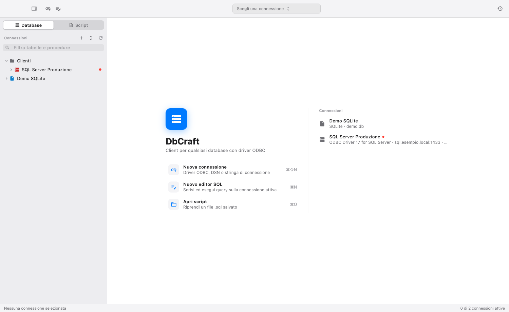 | 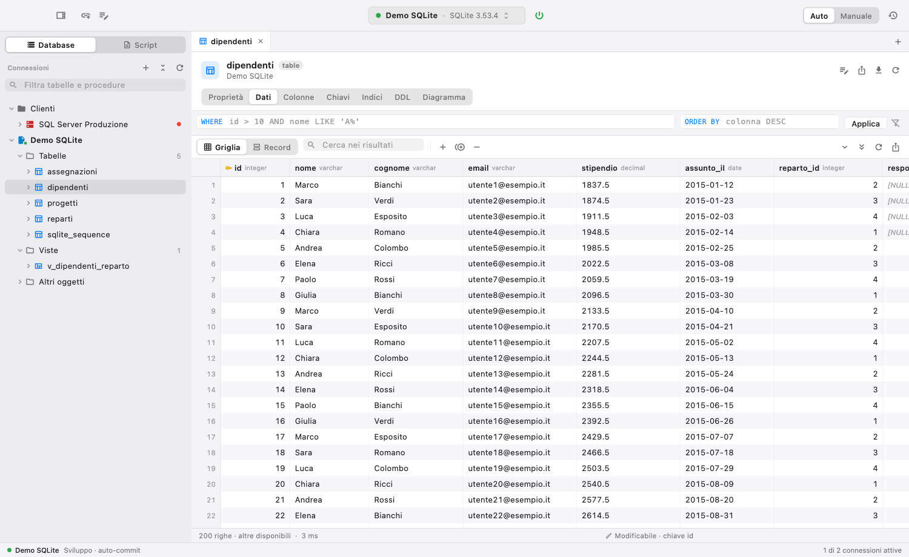 |
| 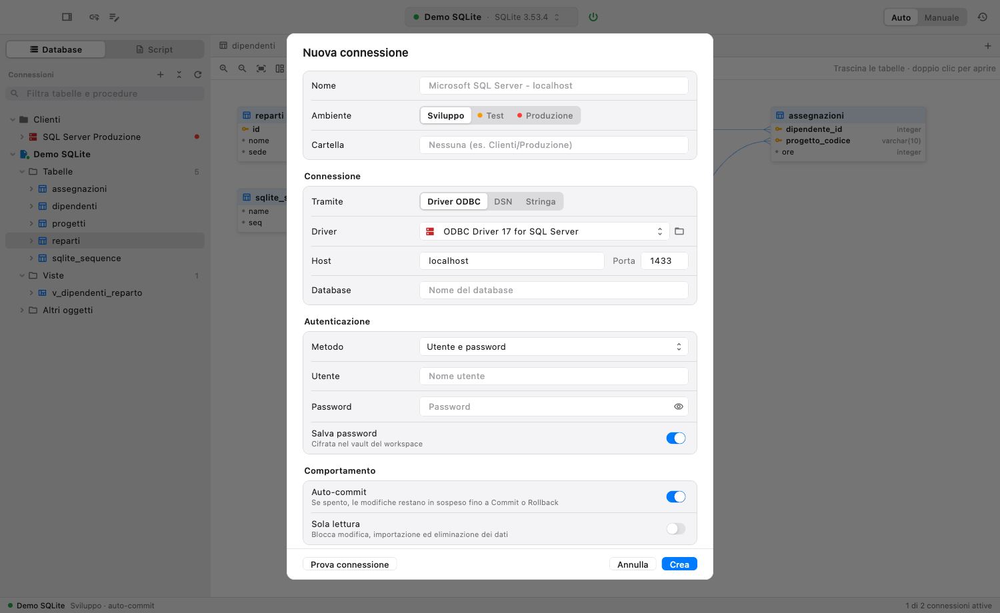 | 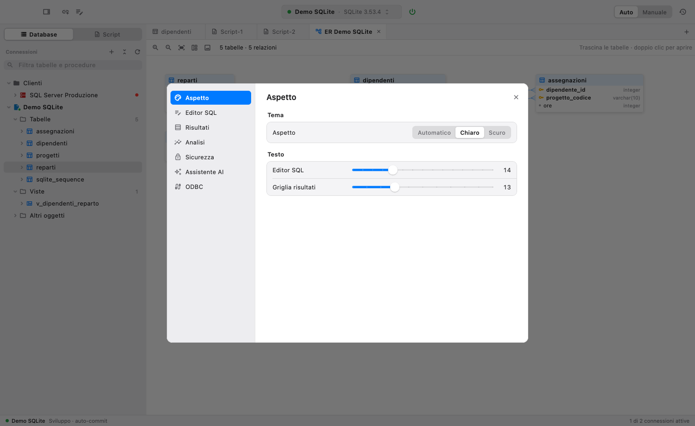 |
| 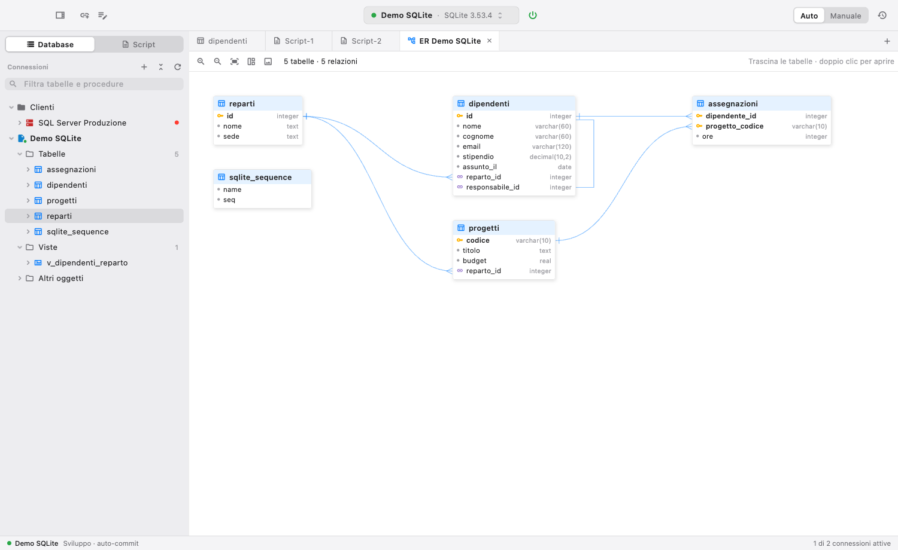 | 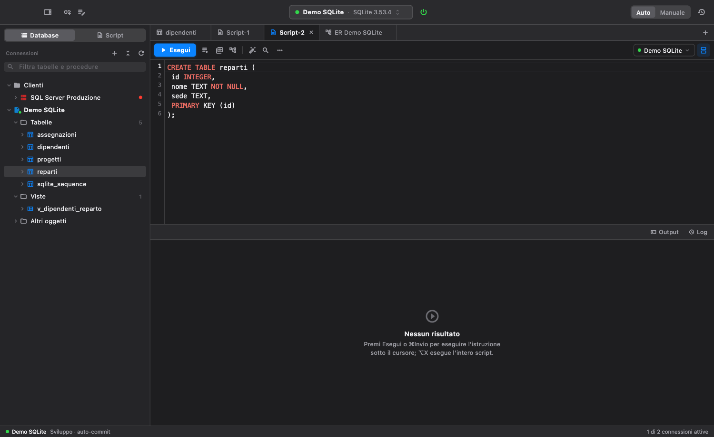 |
| 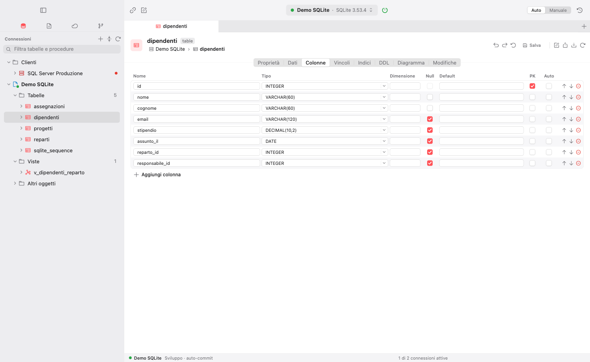 | 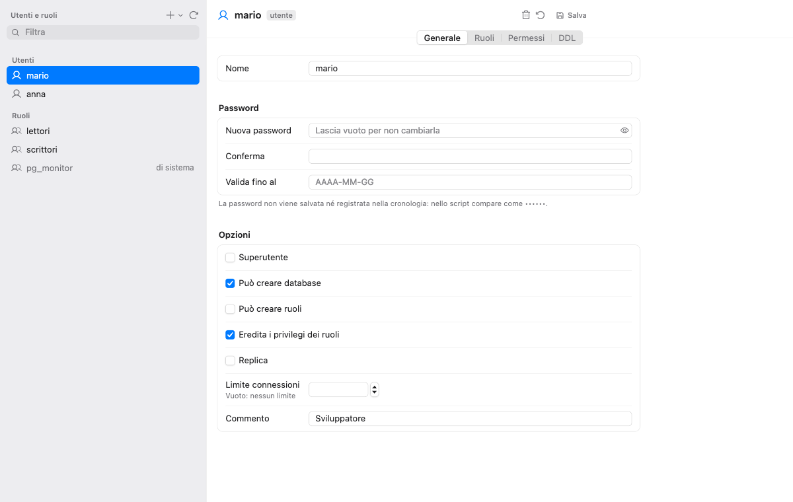 |
| 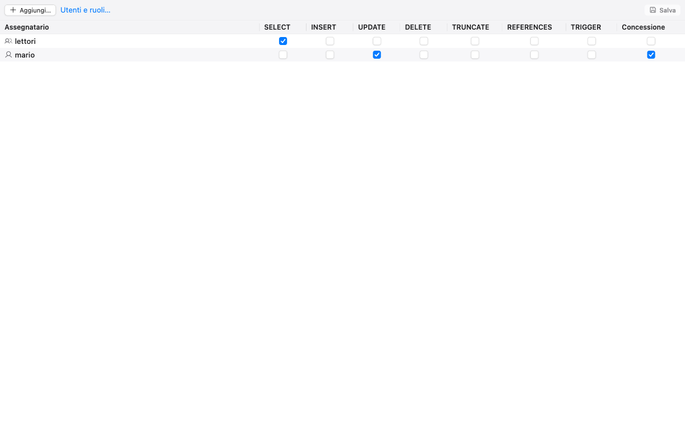 | 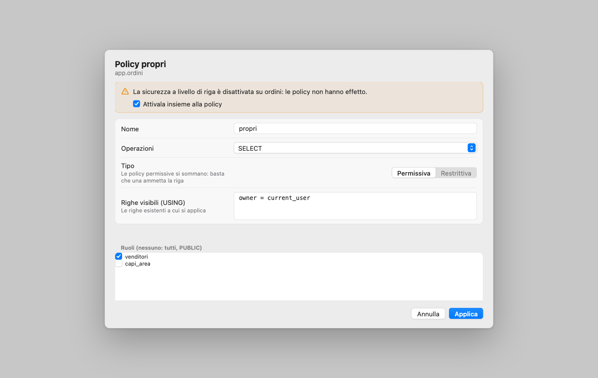 |
| 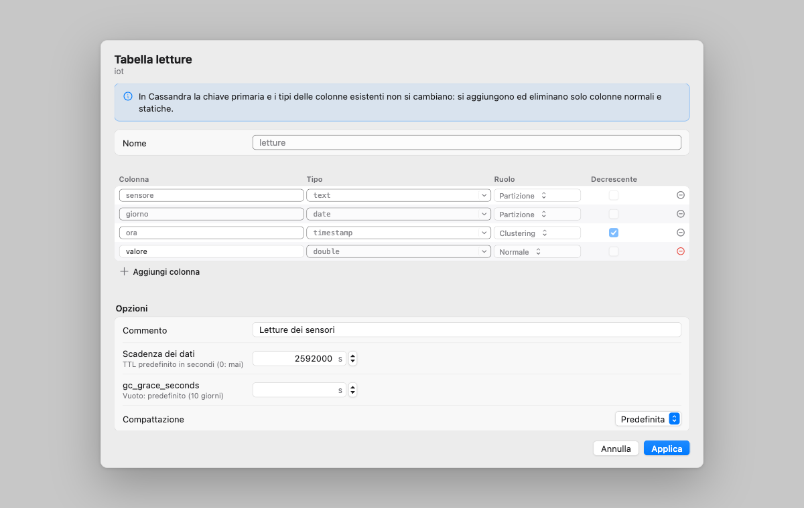 | |
